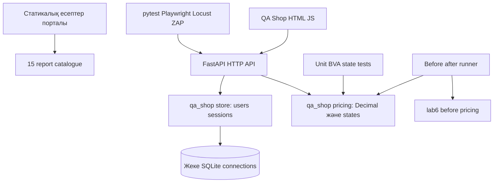

# DebugLab KZ архитектурасы

Жоба оқу материалдарын бір ортақ тексерілетін қосымшамен байланыстырады. Лабораторияның әдейі қате нұсқалары production route-тарға импортталмайды. Осылайша бастапқы ақауды қайта өндіру мен corrected regression suite бір репозиторийде сақталады.

## Қабаттар



## Құрылым

```text
backend/
  app/                 FastAPI factory, router, report catalogue
  qa_shop/             Ортақ domain, repository, HTTP adapter
  lab1/ ... lab15/     Әр жұмыстың REPORT және арнайы evidence/tests
  tests/               Бұрынғы lab7/lab8 API compatibility tests
frontend/              Framework-free HTML, CSS, JavaScript
scripts/               Portable launcher, build, demo, quality runner, summary
conftest.py             Shared fixtures және before variant selection
pyproject.toml          Root discovery, markers, Ruff және coverage scope
.github/workflows/      Full quality gate, Pages және existing SRO jobs
sro7/, sro8/            Бұрынғы өзіндік жұмыстар
```

## Бизнес шекаралары

[pricing.py](backend/qa_shop/pricing.py) Decimal ROUND_HALF_UP, quantity 1–100, percent 0–100, discount-тан кейінгі delivery және explicit state graph береді. HTTP/SQLite туралы білмейді.

[store.py](backend/qa_shop/store.py) параметрлік SQL, PBKDF2 SHA256 + random salt, token digest, TTL және revocation орындайды. Әр операция connection-ды өзі ашады, commit/rollback жасайды және finally-де жабады. Көп сұрау бір global connection-ды бөліспейді.

[api.py](backend/qa_shop/api.py) input schema, status code және dependency injection береді. Server catalogue бағасы authoritative; quote body өз бағасын енгізе алмайды. Money JSON-де string ретінде қайтады.

## Application factory

[create_app](backend/app/main.py) DB path-ты argument/QA_DATABASE арқылы алады. Tests tmp_path, browser өз DB, load/ZAP уақытша DB қолданады. Default dev database `backend/.data` ішінде және Git-ке кірмейді. Existing lab7/lab8 API routes және lab9 documentation pages сақталған.

## Frontend және build

Frontend HTML/JS болып қалады: React/Vite жөніндегі ескі іске қосу тәуелділігі алынып тасталды. `npm run dev` бір FastAPI process-пен UI және API-ді бір origin-де береді; бос порт таңдалады. `npm run build` `dist` жасайды және 15 report-ты labs.json-ға қосады. GitHub Pages сол static build-ті орналастырады; дүкен API-і server environment талап етеді.

## Тестілеу және evidence

Tests pure unit → DB/API integration → HTTP workflows → Chromium E2E қабаттарымен ұйымдастырылған. Қате implementation тек explicit QA_VARIANT=before кезінде fixture-ге беріледі. Жаңа negative tests қауіпсіз exception type пен exact status тексереді.

`npm run check` stage нәтижелерін сақтайды; `npm run lab15` қосымша browser/load/ZAP іске қосады. [summarize_results.py](scripts/summarize_results.py) нақты JUnit/JSON/CSV-ден metrics жасайды. Тарихи lab8 API simulation-ы нақты debugger немесе live scanner орнына ұсынылмайды.

## Өзгерту шегі

Бұл модульдік monolith: оқу нысанына microservices, message broker немесе артық abstraction қажет емес. Production қолдану үшін rate limiting, HTTPS termination, audit retention және operational monitoring қосылады; олар local laboratory scope-ынан тыс.
