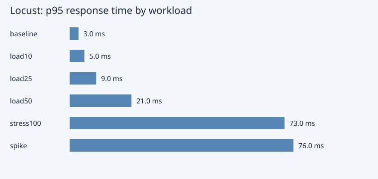

# 11 зертханалық жұмыс Performance және Load Testing

Нысан — жергілікті `/api/shop/products` және case-insensitive search. [run_load.py](run_load.py) уақытша дерекқормен жеке сервер ашады, Locust іске қосады және серверді міндетті түрде тоқтатады.

## 1 Performance объектісі

Public catalogue/read path таңдалды: 75% catalogue, 25% search. Login PBKDF2 және quote write path бұл workload-қа кірмейді; оларды өлшеу үшін бөлек профиль қажет.

## 2 Талаптар

50 VU қысқа жергілікті профиль үшін p95 ≤ 200 ms және error rate ≤ 1%. HTTP status-пен бірге JSON нәтижесі тексеріледі: catalogue 3 тауар, search бірінші ID=1. Think time 20–50 ms.

## 3 Baseline Response Time

1 user, 8 seconds. [baseline_stats.csv](results/baseline_stats.csv) average, median, p95 және max береді. Клиент measured HTTP уақытын есептейді; бұл функцияның CPU уақыты емес.

## 4 Throughput

Throughput = completed requests / elapsed test seconds. Locust `Requests/s` мәні алынады, CLI process startup wall time denominator ретінде қолданылмайды. Әр profile row [summary.json](results/summary.json) ішінде.

## 5 Он пайдаланушы

10 VU, spawn rate 10/s, run time 8 s. [load10_stats.csv](results/load10_stats.csv). Baseline-мен p95 және RPS салыстырылады.

## 6 Жиырма бес пайдаланушы

25 VU, spawn rate 25/s. [load25_stats.csv](results/load25_stats.csv). Error/response contract барлық request үшін сақталады.

## 7 Елу пайдаланушы

50 VU, spawn rate 50/s. Бұл NFR01–02 қабылдау профилі. [load50_stats.csv](results/load50_stats.csv) және final summary actual latency/error rate көрсетеді.

## 8 Жүз пайдаланушы жоспары

Қадам: 50-ден кейін 100 VU, spawn 100/s, 8 s, p95/errors/RPS салыстыру. Бұл жоспар `stress100` ретінде де орындалды. Ұзақ capacity бағалауда 2 min warm-up, 10 min steady және 2 min cool-down қажет.

## 9 Load Test

Baseline → 10 → 25 → 50 VU тізбегі. Әр profile бөлек Locust process және жеке CSV prefix алады. `npm run lab11` барлық run-ды қайталайды.

## 10 Stress Test

100 VU қысқа stress profile негізгі 50 VU target-тен екі есе жоғары. [stress100_stats.csv](results/stress100_stats.csv). Күтпеген crash/error ізделеді; осы деңгейде жүйе сынбаса, бұл breaking point табылды деген сөз емес.

## 11 Spike Test

`SpikeShape`: 0–3 s 10 VU → 3–6 s 100 VU → 6–9 s 10 VU. 100/s spawn өсуді жылдамдатады. [spike_stats_history.csv](results/spike_stats_history.csv) уақыт бойынша latency/throughput береді.

## 12 Endurance жоспары

Жеке run: 50 VU, 2 h steady, wait time 20–50 ms; әр 10 s RSS, CPU, open file descriptors, response p95 және SQLite locks тіркеледі. Acceptance: error ≤1%, p95 ≤200ms, RSS өсуі warm-up-тан кейін ≤10%. Команда: `node scripts/python.mjs -m locust -f backend/lab11/locustfile.py --headless -u 50 -r 10 -t 2h --host http://127.0.0.1:8000 --csv backend/lab11/results/endurance`. Екі сағаттық run жоспарланған, қысқа профильдер оның нәтижесі деп көрсетілмейді.

## 13 Locust сценарийі

[locustfile.py](locustfile.py) HttpUser, between wait және weighted tasks қолданады. `catch_response=True` 200 болғанымен қате JSON-ды failure ретінде белгілейді. Spike shape тек LOCUST_SPIKE=1 кезінде белсенді.

## 14 Virtual Users

CLI --users/--spawn-rate: 1/1, 10/10, 25/25, 50/50, 100/100. Қарапайым профильде duration=8s; spike shape=9s. VU — қатар жұмыс істейтін сценарий орындаушысы; ол бір мезгілдегі TCP request санына дәл тең емес.

## 15 Response Time

Average және p95 ms сақталады; percentile бірліктері ауыстырылмайды. Бірінші өлшеуде 50 VU p95 23 ms болған, бірақ қайталанған run-ның authoritative мәндері [summary.json](results/summary.json) мен [SUMMARY.md](../lab15/results/SUMMARY.md) ішінде.

## 16 Error Rate

Error Rate = failed requests / total requests × 100%. Бос workload 100% error ретінде саналады және runner FAIL береді. Initial алты profile-де request error болмады; әр қайта run нақты counts сақтайды.

## 17 Throughput салыстыру

1→10→25→50→100 VU кезінде RPS өсімі және response latency бірге қаралады. Жаңа VU-лар response time-ды қатты өсіріп, RPS аз өсірсе, saturation белгісі. Тек «көп RPS» нәтижесі бизнес дұрыстығын алмастырмайды.

## 18 Bottleneck талдауы

Initial 50→100 VU кезінде throughput шамамен 1015→1298 RPS, average 12.7→36.2ms өсті. Бұл read path-та queueing/CPU шектеуін зерттеуге негіз, бірақ нақты cause CPU profiler-сіз бекітілмейді. Test client пен бір Uvicorn worker бір хостта: client saturation да ықтимал. Келесі диагностика — separate host generator және server CPU/thread-pool profiling.

## 19 Performance графигі

График сақталған JSON/CSV өлшемдерінен жасалады; әр баған profile p95 ms көрсетеді. Машинамен оқылатын actual мәндер [summary.json](results/summary.json) ішінде.

## 20 Қорытынды

Baseline, 10/25/50 VU load, 100 VU stress және spike орындалды; CSV, history, logs және график сақталды. 100 VU жоспары тәжірибеде тексерілді; endurance жеке жоспар ретінде берілді. Нәтиже жергілікті read workload үшін жарамды және production SLA-ға тікелей көшірілмейді.
