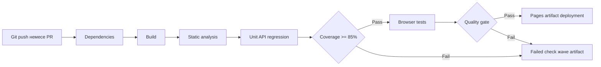

# 14 зертханалық жұмыс CI CD және Continuous Testing

Репозиторий үшін build, analysis, test, coverage және browser тексерулері бар workflow дайындалды. Сол quality commands жергілікті ортада да орындалады; before/after арқылы failed test-тің gate-ке әсері көрсетіледі.

## 1 Git репозиторий

ExampleQA бұрыннан Git репозиторийі. Зертханалар қолданыстағы тарихты сақтап толықтырылады; қайта init қажет емес. Қате код пен corrected код separate modules ретінде version control-ға кіреді.

## 2 Жобаны орналастыру

Базалық жоба [GitHub ExampleQA](https://github.com/Akira-vs96/ExampleQA) ішінде бұрыннан бар. Осы өзгерістер local working tree-де дайын. Workflow жаңа commit/push немесе manual dispatch кезінде remote runner-де орындалады; осы есеп local run-ды GitHub remote execution деп көрсетпейді.

## 3 Unit Test

[6 жұмыс](../lab6/tests/test_units.py) және басқа Python suites CI `npm run check` командасына кіреді. Test discovery root pyproject арқылы backend, sro7 және sro8-ді қамтиды.

## 4 Dependency файлдары

[requirements-dev.txt](../../requirements-dev.txt) runtime/static/coverage/load құралдарын, [package-lock.json](../../package-lock.json) Playwright dependency graph-ын бекітеді. Python 3.13 және Node 22 workflow-де таңдалған.

## 5 CI платформасы

GitHub Actions таңдалды: repository-ге тікелей қосылады, Ubuntu runner, artifact upload және Pages бар. Workflow permissions тек contents:read; deployment permissions бөлек Pages workflow-де.

## 6 Workflow

[labs.yml](../../.github/workflows/labs.yml) push, pull_request және workflow_dispatch trigger алады. Existing SRO workflows сақталған. Бір failed step кейінгі dependent check-терді өткізбейді; artifact upload `if: always()` арқылы failure кезінде де орындалады.

## 7 Build Stage

`npm run build` static portal мен 15 Markdown report-тан labs.json құрады. Missing report build failure береді. React/Vite dependencies қажет емес: frontend осы repository-де HTML/CSS/JS.

## 8 Test Stage

`pytest -q --cov=qa_shop --cov-branch --cov-fail-under=85 ...`. JUnit XML және coverage JSON/XML/HTML жазылады. Күтпеген failed/error test quality command exit code-ын nonzero етеді.

## 9 Static Analysis Stage

Ruff root quality code-ты тексереді; intentionally faulty before modules explicit excluded. Lab8 before/after бөлек Pylint, Ruff және Radon арқылы қаралады. Corrected analysis failure gate-ті тоқтатады.

## 10 Coverage

Minimum combined statement/branch coverage = 85%, source scope `qa_shop`. Coverage пайызын тексеру CLI exit code арқылы орындалады; тек report шығару жеткіліксіз. [15 жұмыстың coverage есебі](../lab15/results/coverage.json) нақты мәндерді сақтайды.

## 11 Pipeline іске қосу

Жергілікті equivalent pipeline: `npm run check`. Ал local failed→fixed demonstration: `npm run lab14`. Remote GitHub run жаңа commit push/dispatch-ты қажет етеді; осы тапсырмада remote release жарияланған жоқ.

## 12 Pipeline нәтижесі

Stage-level command, duration және exit code [checks.json](../lab15/results/checks.json) немесе [full-checks.json](../lab15/results/full-checks.json) ішінде. Тәуелсіз specialized tests үшін `npm run lab15` browser/load/ZAP та орындайды.

## 13 Әдейі тест қатесі

`QA_VARIANT=before` fixture faulty pricing-ті dedicated regression suite-ке береді. Expected remains 6000, 8000, 0, 10600 және forbidden transition. Бұл live corrected source-ты бүлдірмей нақты failing test жасайды.

## 14 Failed Pipeline

[results/before.xml](results/before.xml) және [before.txt](results/before.txt): 5 failed test, pytest exit 1. GitHub step дәл осындай exit code алса job failed болады. Бұл local test-stage demonstration, remote Actions run URL-і емес.

## 15 Қатені түзету

Default corrected `qa_shop.pricing` таңдалады; suite expected өзгермейді. Formula, boundary, delivery order және state validation дұрыс нұсқаға ауысады.

## 16 Қайта орындау

[results/after.xml](results/after.xml): 10 passed, exit 0. [comparison.json](results/comparison.json) before exit=1 және after exit=0 шарттарын тексеріп, demonstration_passed сақтайды.

## 17 Quality Gate

Build success; Ruff zero diagnostics; corrected pytest no failure/error; coverage≥85%; lab8 Pylint/Radon/tests gate PASS; browser checks PASS. External DummyJSON run негізгі offline CI-ге кірмейді, себебі third-party service behavior-іне тәуелді.

## 18 Test Artifact

Workflow JUnit, coverage, before/after, screenshots, browser report және dist artifact-тарын 14 күн сақтайды. Local file-дар `backend/lab*/results` ішінде. GitHub-тың стандартты job status/check notifications механизмі қолданылады; бөлек email/Slack жіберілмейді.

## 19 Continuous Testing схемасы

Pages deployment quality job нәтижесіне dependency ретінде [Pages workflow](../../.github/workflows/pages.yml) арқылы байланыстырылған. Production backend deployment бұл оқу жобасының scope-ына кірмейді.

## 20 CI CD есебі

Pipeline source, local successful quality run және intentional failed/fixed evidence дайын. GitHub remote execution пен local execution мәртебелері ажыратылған. Continuous testing әр өзгерісте source contract, regressions және coverage-ті бір командамен тексереді.
