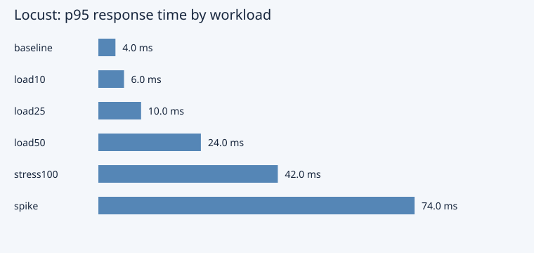

# QA Shop нақты тексеру нәтижелері

Жаңартылғаны UTC: 2026-11-24T10:37:28.369475+00:00

Localhost оқу демонстрациясы: **NO GO**.
Production: **NO GO**; rate limiting, deployment hardening, кеңейтілген security және endurance қажет.

| Тексеру | Нақты нәтиже |
|---|---|
| PDF есептері | 15/15; тапсырмалар 300/300 |
| Pytest | 238/240 passed; failed 0; errors 0; expected failures 2; skipped 0 |
| Pass Rate | 99.17% |
| Coverage combined statement/branch | 100.0%; minimum 85% |
| Statements | 161/161 |
| Branches | 24/24 |
| Chromium | 13 expected; 0 unexpected; 0 skipped |
| 50 VU | p95 24.0 ms; errors 0.0% |
| ZAP corrected | 0 alerts |

## Before және After

| Suite | Before | After |
|---|---|---|
| Lab 4 | 11 passed / 20 failed | 31 passed / 0 failed |
| Lab 6 | 12 passed / 22 failed | 34 passed / 0 failed |
| Lab 13 | 5 passed / 5 failed | 10 passed / 0 failed |
| Lab 14 | 5 passed / 5 failed | 10 passed / 0 failed |
| Lab 5 catalogue | 1/20 PASS | 20/20 PASS |

## Coverage scope

Python qa_shop package; JavaScript және external API бұл пайызға кірмейді.

| Source | Statements covered/total | Branches covered/total | Combined |
|---|---|---|---|
| backend/qa_shop/__init__.py | 0/0 | 0/0 | 100.00% |
| backend/qa_shop/api.py | 68/68 | 10/10 | 100.00% |
| backend/qa_shop/pricing.py | 36/36 | 12/12 | 100.00% |
| backend/qa_shop/store.py | 57/57 | 2/2 | 100.00% |

## Performance

8-second local read profiles; spike 10→100→10 users. Бір host, production SLA емес.

| Profile | VU | Requests | Failed | Average ms | p95 ms | RPS |
|---|---:|---:|---:|---:|---:|---:|
| baseline | 1 | 179 | 0 | 3.37 | 4.0 | 25.63 |
| load10 | 10 | 1771 | 0 | 3.98 | 6.0 | 252.80 |
| load25 | 25 | 4274 | 0 | 5.27 | 10.0 | 609.94 |
| load50 | 50 | 7310 | 0 | 11.51 | 24.0 | 1041.96 |
| stress100 | 100 | 11941 | 0 | 21.08 | 42.0 | 1700.29 |
| spike | 100 | 4846 | 0 | 35.00 | 74.0 | 536.43 |

## ZAP passive scan

| Variant | Version | Alerts | High | Medium |
|---|---|---:|---:|---:|
| before | 2.17.0 | 4 | 0 | 2 |
| after | 2.17.0 | 0 | 0 | 0 |

Scope: тек local shop pages/assets және public catalogue/search; authenticated passive scan немесе толық pentest емес.

## External Lab 9

DummyJSON, recorded 2026-10-30T18:46:15.570Z: {'planned': 34, 'executed': 34, 'passed': 33, 'failed': 1}. Нақты assertion failures [Lab 9 есебінде](../../lab9/results/RUN_RESULTS.md).
Third-party finding жергілікті corrected pytest нәтижесіне қосылмайды; профильдің password өрісі бойынша LAB9-01 ашық finding ретінде сақталған.

## Quality stages

| Stage | Exit | Seconds |
|---|---:|---:|
| build | 0 | 0.33 |
| analysis | 0 | 0.06 |
| tests | 0 | 40.24 |
| cases | 0 | 0.03 |
| debugger | 0 | 0.05 |
| before-after | 0 | 3.04 |
| pipeline-demo | 0 | 1.49 |
| stability | 0 | 2.19 |
| security-demo | 0 | 0.08 |
| lab8 | 0 | 2.74 |
| browser | 0 | 18.52 |
| load | 0 | 52.66 |
| zap | 0 | 21.27 |

## Қабылдау шектері

Remote GitHub Actions run push/dispatch кейін орындалады. Long endurance — жоспар; толық production release осы оқу тексерулеріне кірмейді.

Дәлелдер: [JUnit](pytest.xml), [coverage](coverage.json), [checks](checks.json), [full checks](full-checks.json), [JSON summary](summary.json).
