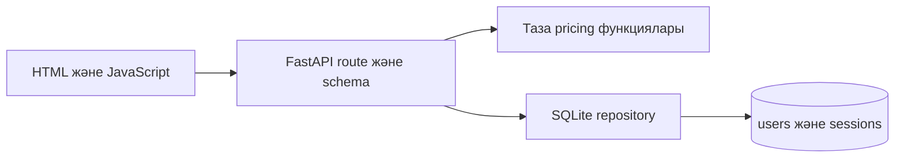

# 3 зертханалық жұмыс Тестілеудің төрт деңгейі

QA Shop бірдей бизнес ережелерін unit, integration, system және acceptance деңгейлерінде тексереді. Орындалатын жинақ: [test_levels.py](tests/test_levels.py).

## 1 Қосымшаның архитектурасы



## 2 Компоненттер

[pricing.py](../qa_shop/pricing.py) ақша мен күйлерді есептейді; [store.py](../qa_shop/store.py) пайдаланушы мен сессияны сақтайды; [api.py](../qa_shop/api.py) HTTP/validation/authentication орындайды; [shop.js](../../frontend/shop.js) пайдаланушы әрекеттерін жібереді. Portal мен зертханалық before нұсқалары production pricing-тен бөлек.

## 3 Unit Test объектілері

`line_total`, `discounted_total`, `shipping_cost`, `order_total`, `transition_order`. Дерекқор да, HTTP да қажет емес; тест нақты return value немесе exception тексереді.

## 4 Бес Unit Test сценарийі

| ID | Функция және дерек | Expected |
|---|---|---|
| U01 | line_total(2500, 2) | 5000.00 |
| U02 | discounted_total(10000, 20) | 8000.00 |
| U03 | shipping_cost(10000) | 0.00 |
| U04 | order_total([(2000, 6)], 20) | 10600.00 |
| U05 | transition_order(new, paid) | paid |

## 5 Unit Test орындау

`npm run lab3` немесе `node scripts/python.mjs -m pytest -q backend/lab3 -m unit`. Бес параметр `test_five_units` арқылы жеке орындалады. Жалпы test suite және coverage нәтижесі [SUMMARY.md](../lab15/results/SUMMARY.md) ішінде.

## 6 Екі компоненттің байланысы

Registration route → Store.register → SQLite INSERT. HTTP 201 жеткіліксіз: integration test SQLite жолын оқып, username және password hash барын, ашық пароль сақталмағанын тексереді.

## 7 Integration Test сценарийлері

I01: тіркелу → HTTP жауаптан құпия өрістер жоқ → SQLite-де user бар. I02: login → cookie → жаңа Store instance → сол token арқылы user табылады. Бұл байланыстар migration, SQL schema және token hashing ақауын ұстайды.

## 8 API интеграциясы

FastAPI `TestClient` HTTP request/response adapter-ін, dependency injection және нақты SQLite-ді бірге іске қосады. Әр fixture уақытша DB қолданады. Бұл in-process integration; нақты TCP/browser E2E [10 жұмыста](../lab10/REPORT.md) бөлек орындалады.

## 9 System Test сценарийі

`test_register_login_search_quote_logout`: register 201 → login 200 → Keyboard search → quote total 10000.00 → logout 204 → profile 401. Бір циклде жүйенің барлық негізгі HTTP компоненттері байланысады.

## 10 End to End сценарийі

Browser-де тіркелу → кіру → есептеу → total 9000.00 → logout → қайта есептеуге тыйым. [Playwright suite](../lab10/tests/shop.spec.mjs) нақты localhost HTTP серверін және Chromium-ды қолданады.

## 11 Acceptance критерийлері

AC01: 10000 subtotal және 20% discount кезінде сатып алушы 8000 + 1000 = 9000 KZT төлейді. AC02: жүйеге кірмеген сатып алушы quote ала алмайды. Критерийлер қолданушының бизнес нәтижесін белгілейді.

## 12 Acceptance Test

`test_customer_pays_delivery_after_discount` барлық бес қаржылық өріс пен currency-ді салыстырады. `test_unregistered_customer_cannot_quote` 401 тексереді. Бұл requirements FR03, FR08–FR10-ға сәйкес келеді.

## 13 Төрт деңгейді салыстыру

| Деңгей | Scope | Негізгі ақау | Құны |
|---|---|---|---|
| Unit | Бір функция | Формула, boundary, state | Ең аз |
| Integration | API + repository | Schema, session persistence | Орташа |
| System | HTTP workflow | Компоненттер реті, contract | Жоғарырақ |
| Acceptance | Бизнес критерий | Қолданушыға қате нәтиже | Бизнеске бағытталған |

## 14 Әр деңгейдегі тест саны

Осы жұмыста 5 unit + 2 integration + 1 system + 2 acceptance = 10 test. Кеңейтілген unit/BVA/security/regression тексерулері кейінгі жұмыстарға тиесілі және final suite-де қайталанбай жиналады.

## 15 Нәтижелерді тіркеу

Corrected нұсқада 10 сценарий PASS болды. Қайта өндіру командасы: `npm run lab3`. Барлық test case аттары, ұзақтығы, failed/error саны [JUnit XML](../lab15/results/pytest.xml) ішінде сақталады.

## 16 Defect тізімі

| ID | Ақау | Қай деңгейде ұсталады | Түзету |
|---|---|---|---|
| D01 | Баға мен сан қосылады | Unit U01 | Көбейту |
| D02 | Пайыз 100-ге бөлінбейді | Unit U02 | /100 |
| D03 | 10000 шегі кірмейді | Unit U03 | ≥ |
| D04 | Жеткізу бастапқы сомамен есептеледі | Unit U04, acceptance | Discounted total |
| D05 | Кез келген state рұқсат етіледі | State regression | Explicit edges |
| D06 | SQLite context транзакциядан кейін connection жаппайды | Coverage run ResourceWarning | `finally: close()` |

## 17 Severity

D01, D02, D04, D05 — High: ақша немесе бизнес ережесі бұзылады. D03 — Medium: boundary-де артық delivery төленеді. D06 — Medium: ұзақ жұмыс кезінде ресурстар жиналуы мүмкін. Priority High/Critical ақшаға және authentication-ге берілді.

## 18 Test Coverage

`npm run check` pytest-cov арқылы `qa_shop` модулінің statement және branch coverage-ын JSON/XML/HTML форматында есептейді. 85% шек CI-де міндетті. Бөлімдер бойынша нақты covered/total мәндер [coverage.json](../lab15/results/coverage.json) және [SUMMARY.md](../lab15/results/SUMMARY.md) ішінде. API coverage браузердегі JavaScript coverage-ын білдірмейді.

## 19 Testing Pyramid

```text
          /  Acceptance + browser E2E  \
         /     System HTTP workflows   \
        /   Integration API + SQLite    \
       / Unit, boundaries, state pairs   \
```

Таза функциялардың комбинациялары төменгі қабатта көп әрі жылдам тексеріледі. Бірнеше бизнес workflow жоғары қабаттағы байланысты тексереді.

## 20 Қорытынды

Unit формуланы дәл тексерсе, integration деректің сақталуын, system ағындардың байланысын, acceptance бизнес нәтижесін дәлелдейді. Төртеуі бірге қолданылды; браузерлік E2E HTTP in-process тестінен бөлек сақталды.
