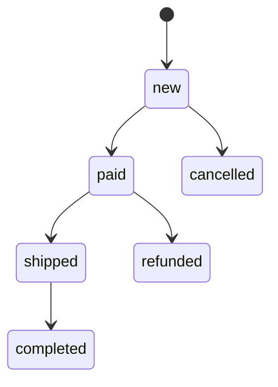
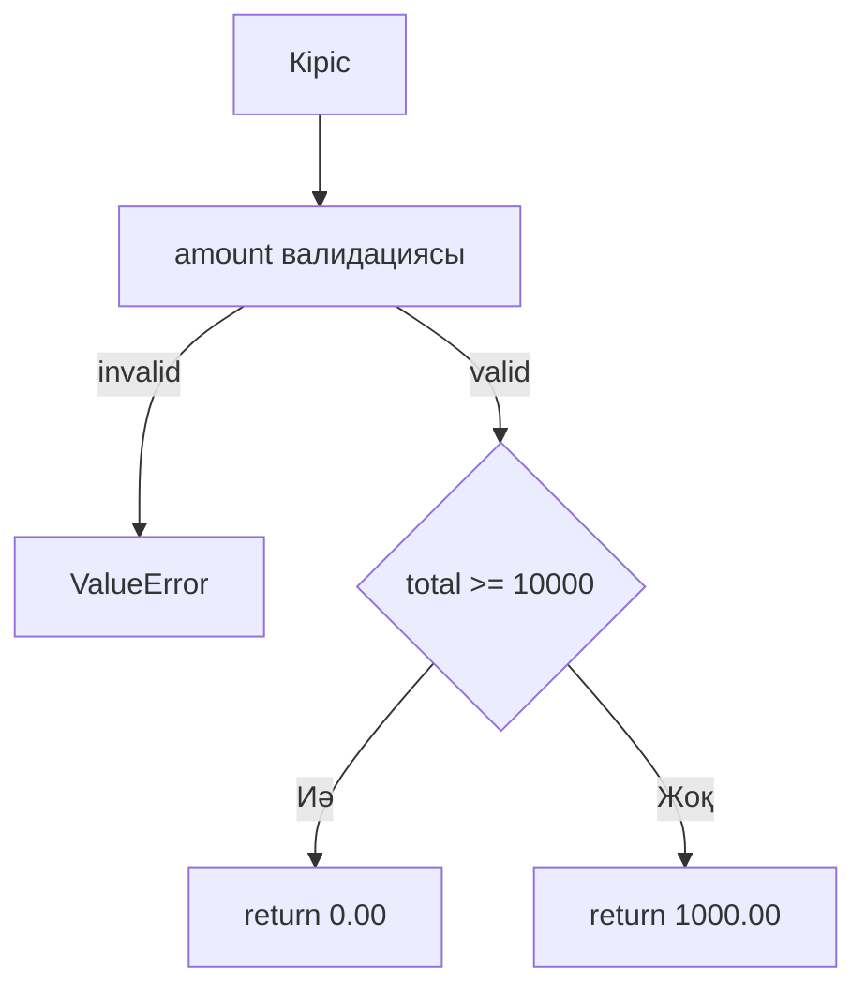

# 4 зертханалық жұмыс Black box және White box

Нысан — тауар бағасы, жеткізу және тапсырыс күйлері. [Тесттер](tests/test_black_white.py) бірдей келісімшартты [қате](../lab6/before/pricing.py) және [түзетілген](../qa_shop/pricing.py) нұсқаларда тексереді.

## 1 Black box объектісі

`line_total(price, quantity)` және `shipping_cost(total)`. Кіріс/шығыс шарты маңызды: quantity бүтін 1–100, price теріс емес, жеткізу шегі 10000.

## 2 Бес эквиваленттік класс

| Класс | Representative | Expected |
|---|---:|---|
| 1-ден төмен бүтін сан | -1 | ValueError |
| 1–100 жарамды бүтін сан | 1 | 100.00 |
| 100-ден жоғары бүтін сан | 101 | ValueError |
| Бөлшек сан | 1.5 | ValueError |
| Сан емес немесе bool | true | ValueError |

Нөл мен 100 boundary suite-те бөлек тексеріледі; string және басқа типтер [6 жұмыста](../lab6/tests/test_units.py) толықтырылады.

## 3 Boundary Value Analysis

Quantity: 0, 1, 2, 99, 100, 101; percent: -1, 0, 1, 99, 100, 101; delivery: 9999.99, 10000.00, 10000.01. Valid және invalid көршілес мәндер таңдалды.

## 4 Он шекаралық тест

| Test | Input | Expected |
|---|---|---|
| B01 | line(100,1) | 100.00 |
| B02 | line(100,2) | 200.00 |
| B03 | line(100,99) | 9900.00 |
| B04 | line(100,100) | 10000.00 |
| B05 | discount(100,0) | 100.00 |
| B06 | discount(100,1) | 99.00 |
| B07 | discount(100,99) | 1.00 |
| B08 | discount(100,100) | 0.00 |
| B09 | shipping(9999.99) | 1000.00 |
| B10 | shipping(10000.00) | 0.00 |

## 5 Decision Table

| Rule | Subtotal ≥ 10000 | Discount | Discounted ≥ 10000 | Delivery |
|---|---|---|---|---:|
| DT1 | Жоқ: 9000 | 0% | Жоқ | 1000 |
| DT2 | Жоқ: 9000 | 20% | Жоқ | 1000 |
| DT3 | Иә: 12000 | 0% | Иә | 0 |
| DT4 | Иә: 12000 | 20% | Жоқ: 9600 | 1000 |

## 6 Decision Table тесттері

`test_delivery_decision_table` төрт жолды орындайды. DT4 бастапқы кодтағы delivery-ді discount-қа дейін есептеу ақауын ұстайды. Expected алдымен бизнес ережесімен есептелді.

## 7 State Transition диаграммасы

completed, cancelled, refunded — терминал күйлер. Басқа ауысулар ValueError береді.

## 8 State Transition тесттері

Бес рұқсат етілген edge, алты атаулы invalid edge және алты күйдің барлық 36 жұбы тексеріледі. Unknown source/target та қате. Күйдің өзіне ауысу рұқсат етілмейді.

## 9 White box коды

`shipping_cost` бір шарттан тұрады: `amount(total) >= FREE_SHIPPING`. `transition_order` source state пен allowed targets-ты тексереді. Validation helper бөлек тесттермен жабылады.

## 10 Control Flow Graph

Shipping decision CFG: бір decision, екі шығыс. Helper-дің exception жолы бөлек домендік validation scope-ына жатады.

## 11 Statement Coverage

Statement coverage = executed statements / executable statements × 100%. Толық suite-де pricing модулінің statement саны және covered саны [coverage.json](../lab15/results/coverage.json) ішінде. Генерацияланған [SUMMARY.md](../lab15/results/SUMMARY.md) оларды пайызбен көрсетеді.

## 12 Branch Coverage

Branch coverage = covered outgoing branches / total outgoing branches × 100%. Shipping-тің True/False жағы B09/B10 арқылы орындалады. State рұқсат етілген және тыйым салынған жолдары да тексеріледі. Өлшенген pricing branch нәтижесі final summary-де берілген.

## 13 Path Coverage

Оқшауланған shipping функциясында valid input үшін екі негізгі жол бар және екеуі де орындалды. Әр helper, exception және order loop комбинациясын қосқандағы барлық ықтимал жүйелік path саны шектелмейді; 100% branch coverage толық path coverage дегенді білдірмейді.

## 14 Cyclomatic Complexity

Бір бинарлық decision бар shipping үшін V(G) = decisions + 1 = 2; балама формула E − N + 2P. Нақты функциялардың Radon өлшемі [complexity.json](../lab15/results/complexity.json) ішінде сақталады. Құрама boolean өрнегі бірнеше independent condition қосуы мүмкін.

## 15 Негізгі тест жолдары

P1 valid amount, total 9999.99 → 1000; P2 valid amount, total 10000 → 0; P3 invalid amount → exception; P4 valid state edge → target; P5 invalid/unknown edge → exception.

## 16 Тестілерді орындау

`npm run lab4` corrected нұсқаны тексереді. `npm run demo` сол suite-ті before және after нұсқаларда іске қосады. [before.txt](results/before.txt), [after.txt](results/after.txt) және [comparison.json](results/comparison.json) нақты exit code пен assertions сақтайды.

## 17 Нәтижелерді салыстыру

Black box boundary кезінде формула мен жеткізу ақауын, White box күй/branch кезінде рұқсатсыз ауысуды анықтады. Before run FAIL, after run PASS. Нақты test саны мен failure себептері сақталған JUnit-те бар.

## 18 Defect тізімі

BB01: addition орнына multiplication, High; BB02: пайызды /100 түрлендірмеу, High; BB03: delivery `>` орнына `>=`, Medium; BB04: discount-қа дейін delivery, High; WB01: allowed-edge validation жоқ, High. Түзетулер [pricing.py](../qa_shop/pricing.py) ішінде.

## 19 Тиімділікті бағалау

Black box бизнес contract сақталуын код құрылымынан тәуелсіз бағалайды. White box орындалмаған тармақты және күйдегі рұқсаттарды табады. Қарапайым formula үшін екеуін бірге қолдану артық boundary мен missing validation-ды анықтады.

## 20 Есеп және қорытынды

5 partition, 10 атаулы boundary case, decision table, state graph және CFG дайындалды. Runtime evidence бастапқы ақауды және түзетудің жұмысын көрсетеді. Statement/branch метрикасы source scope-ымен бірге беріледі; жоғары coverage қатесіздіктің кепілдігі емес.
