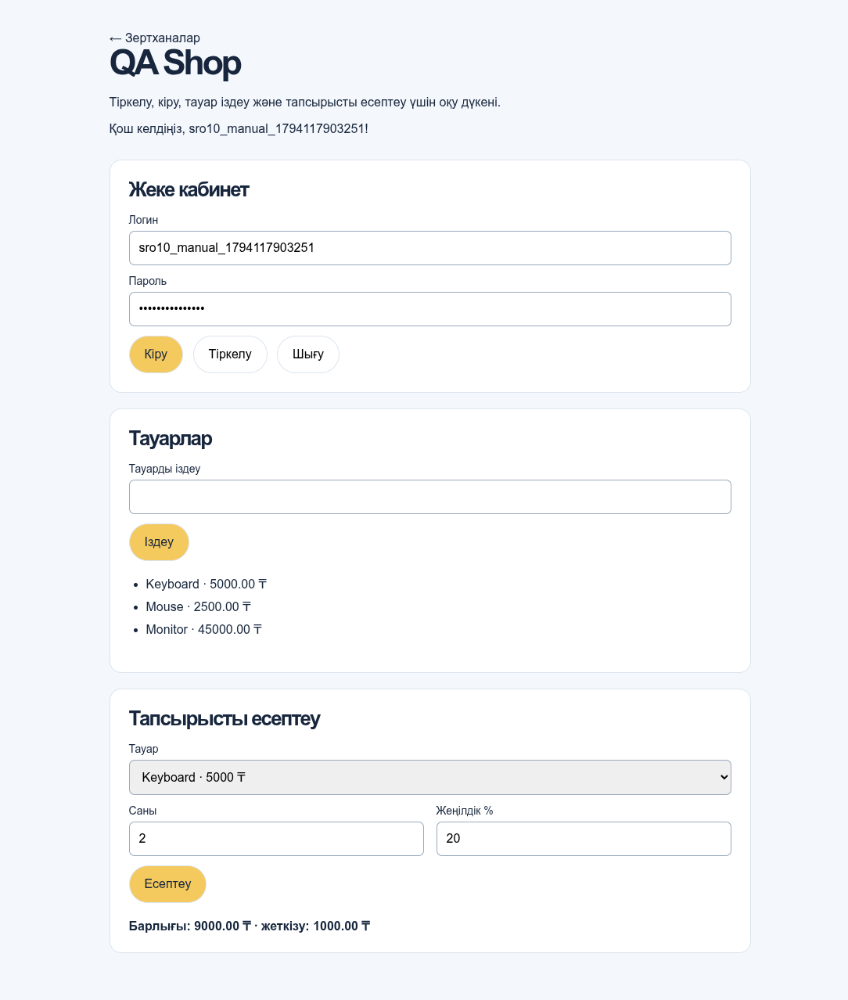
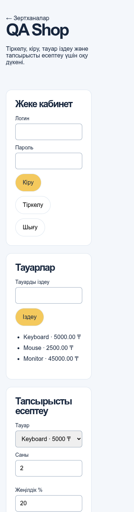
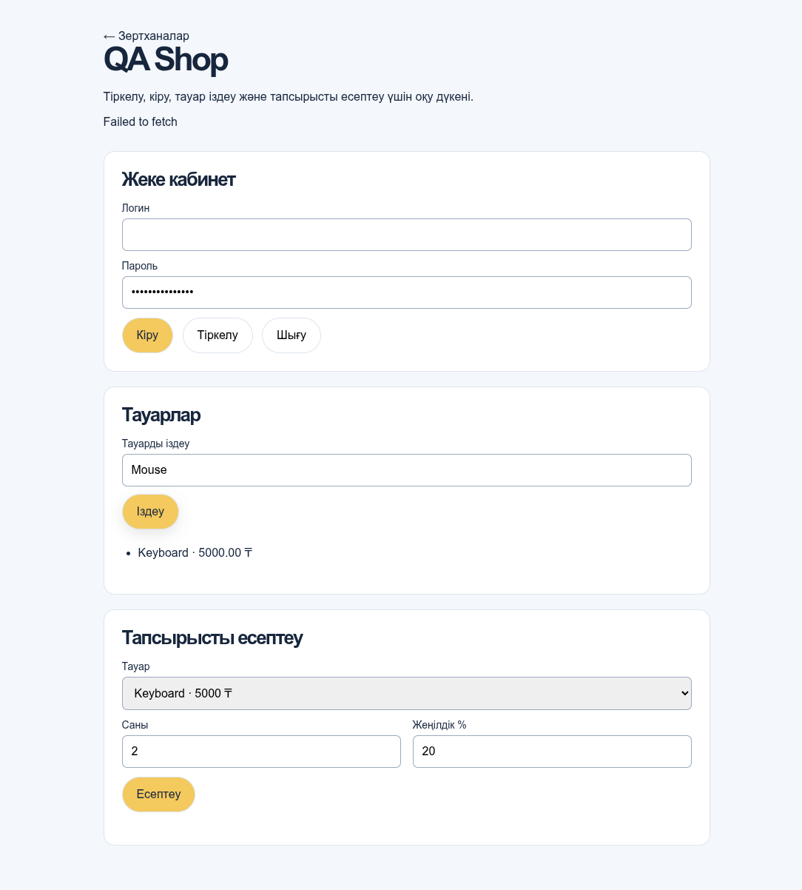
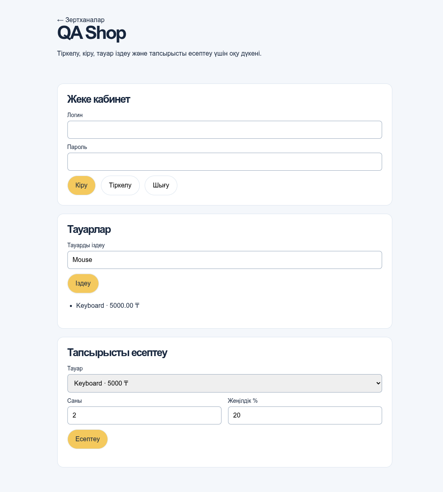

# СРО №10

**Веб-қосымшаны функционалдық, интерфейстік және автоматтандырылған тестілеу**

Орындаған: Абинсериков Нурасыл АЖ-41.
Күні: 08.11.2026. Есеп нақты жергілікті іске қосудан жасалды:
`2026-11-11T03:18:41.839967+00:00`.

## Жұмыстың мақсаты

Веб-қосымшаның негізгі мүмкіндіктерін талдау, дұрыс/қате деректер мен шекаралық
мәндер үшін тест-кейстер дайындау, интерфейс пен HTTP сұраныстарын тексеру,
Playwright және pytest арқылы автоматтандыру, табылған ақауларды тіркеу.

## 1-кезең. Сайтты таңдау және талдау

Таңдалған сайт — осы жобадағы **QA Shop** оқу дүкені.
Интерактивті тексеру мекенжайы: `http://127.0.0.1:8000/shop.html`.
Мысалдағы университет порталының орнына сол талаптарға сай дүкен таңдалды.
Email өрісі болмағандықтан, міндетті өріс тексерісі нақты Логин өрісіне бейімделді.
Автотесттер серверді бос localhost портында өздері қосып, уақытша SQLite базасын қолданады.

Негізгі функциялар:

- Логин және құпиясөз арқылы тіркелу, кіру, сессиядан шығу.
- Үш тауарды көру; атауы бойынша регистрге тәуелсіз іздеу.
- Тауар санын, жеңілдік пен жеткізуді ескеріп тапсырысты есептеу.
- Зертханалар порталына қайту; мобильді экран және пернетақтамен жұмыс.

Нақты қабылдау талаптары: логин 3–40 таңба, тек латын әріптері/цифр/астыңғы сызық;
құпиясөз 8–128 таңба; іздеу ең көбі 80 таңба; саны 1–100 бүтін сан;
жеңілдік 0–100 бүтін пайыз. Keyboard=5000 ₸, Mouse=2500 ₸, Monitor=45000 ₸.
Жеңілдіктен кейінгі сома 10000 ₸-ден бастап жеткізу тегін, одан төменде 1000 ₸.
Жеке дерек пен есептеу үшін сессия қажет. Желі қатесі түсінікті көрсетілуі,
іздеу нәтижесі соңғы сұранысқа сәйкес болуы тиіс.

## 2-кезең. Тест-кейстерді құрастыру

**20 тест-кейс** дайындалды: оң, теріс, шекаралық, интерфейстік және желілік жағдайлар.
Әр жағдайдың алғышарты, қадамдары, енгізілетін деректері, күтілетін және нақты
нәтижелері [TEST_CASES.md](TEST_CASES.md) және [CSV кестесінде](test_cases.csv) берілген.

| ID | Сценарий | Нақты нәтиже |
| --- | --- | --- |
| WEB-01 | Бетті ашу және негізгі элементтер | ӨТТІ (2 тексеріс) |
| WEB-02 | Тіркелу және дұрыс деректермен кіру | ӨТТІ (1 тексеріс) |
| WEB-03 | Қате құпиясөз | ӨТТІ (1 тексеріс) |
| WEB-04 | Міндетті логин өрісі бос | ӨТТІ (1 тексеріс) |
| WEB-05 | Құпиясөздің төменгі шегінен аз | ӨТТІ (1 тексеріс) |
| WEB-06 | Ең қысқа жарамды деректер | ӨТТІ (1 тексеріс) |
| WEB-07 | Үлкен әріппен тауар іздеу | ӨТТІ (1 тексеріс) |
| WEB-08 | Табылмайтын тауар | ӨТТІ (1 тексеріс) |
| WEB-09 | Бос іздеу сұранысы | ӨТТІ (1 тексеріс) |
| WEB-10 | Мобильді және жұмыс үстелі экраны | ӨТТІ (3 тексеріс) |
| WEB-11 | Пернетақтамен навигация | ӨТТІ (1 тексеріс) |
| WEB-12 | Сессиясыз қорғалған ресурс | ӨТТІ (1 тексеріс) |
| WEB-13 | Желілік қате хабарламасы | АҚАУ: BUG-10-01 |
| WEB-14 | Жеңілдікпен тапсырысты есептеу | ӨТТІ (1 тексеріс) |
| WEB-15 | Тауар санының шектері | ӨТТІ (4 тексеріс) |
| WEB-16 | Шығу сессияны жояды | ӨТТІ (1 тексеріс) |
| WEB-17 | Іздеу сұранысының ұзындығы | ӨТТІ (2 тексеріс) |
| WEB-18 | Соңғы іздеудің нәтижесі сақталуы | АҚАУ: BUG-10-02 |
| WEB-19 | Порталға қайту | ӨТТІ (1 тексеріс) |
| WEB-20 | Жеңілдік пайызының шектері | ӨТТІ (4 тексеріс) |

## 3-кезең. Қолмен және интерактивті тексеру

Нақты браузерде бет, формалар, іздеу, қате хабарламалары және Tab навигациясы
тексерілді. Интерактивті тексерістер [manual_checks.json](results/manual_checks.json)
ішінде жазылған. Тексеру браузер құралдары арқылы орындалды; Network панеліндегі
сұраныстарға балама request/response бақылауы қолданылды.

Формалар: бос логинде native required хабарламасы шығып, valueMissing=true болды.
Қате құпиясөз 401 қайтарды. KEYBOARD сұранысы бір Keyboard тауарын көрсетті.
375, 768, 1440 px экрандарда көлденең жылжу байқалмады.
Tab реті: username → password → login → register → logout → query.
Басқарылатын желі үзілісі мен жауаптардың кері реті екі ақауды қайталады.

DevTools арқылы қайталау: F12 → Network → Fetch/XHR сүзгісі → Preserve log;
форманы жіберіп, Method, Status, Payload, Response өрістерін қарау.
Төмендегі кодтар нақты тексерілді:

| Әрекет | HTTP сұранысы | Нақты мәртебе |
| --- | --- | --- |
| Тіркелу | POST /api/shop/register | 201 Created |
| Дұрыс кіру | POST /api/shop/login | 200 OK |
| Қате құпиясөз | POST /api/shop/login | 401 Unauthorized |
| Тауар іздеу | GET /api/shop/products?q=KEYBOARD | 200 OK |
| Сессиясыз жеке дерек | GET /api/shop/me | 401 Unauthorized |
| Есептеу | POST /api/shop/quote | 200 OK |
| Шығу | DELETE /api/shop/session | 204 No Content |
| Іздеу ұзындығы 81 | GET /api/shop/products?q=… | 422 Unprocessable Entity |

Нақты есептеу сұранысы:

```http
POST /api/shop/quote
Content-Type: application/json

{"items":[{"product_id":1,"quantity":2}],"percent":20}
```

JUnit-ке сақталған нақты жауап денесі:

```json
{
  "user_id": 4,
  "subtotal": "10000.00",
  "discounted": "8000.00",
  "shipping": "1000.00",
  "total": "9000.00",
  "currency": "KZT"
}
```

Браузердегі fetch сұраныстарының Method/URL/Status/Payload жазбалары
[results/](results/) ішіндегі `*.http.json` файлдарында сақталады;
құпиясөздер журналда жасырылған. API шекаралық тексерістерінің дәлелі — JUnit.
Желі үзілісі HTTP мәртебесімен шатастырылмайды: жауап келмейді, requestfailed пайда болады.

## 4-кезең. Playwright және pytest арқылы автоматтандыру

Орта: Python 3.13.5; pytest 8.3.4;
Playwright 1.56.0; Chromium 141.0.7390.37;
FastAPI 0.115.6; uvicorn 0.34.0.

Міндетті үш тексеріс нақты [test_web.py](test_web.py) файлында бар:
бетті ашу, негізгі элементтердің көрінуі және тіркелу/кіру әрекеті.
Төмендегі үзінді тікелей сол файлдан алынған; fixture-лер
[conftest.py](conftest.py) ішінде сервер мен Chromium-ды басқарады.

```python
def test_web01_open_page(web_page):
    response = web_page.goto("/shop.html")
    assert response.status == 200
    expect(web_page).to_have_title("QA Shop · DebugLab KZ")
    expect(web_page.get_by_role("heading", name="QA Shop", exact=True)).to_be_visible()

def test_web01_main_elements_visible(web_page):
    for heading in ("Жеке кабинет", "Тауарлар", "Тапсырысты есептеу"):
        expect(web_page.get_by_role("heading", name=heading, exact=True)).to_be_visible()
    expect(web_page.get_by_label("Логин", exact=True)).to_be_visible()
    expect(web_page.get_by_label("Тауарды іздеу")).to_be_visible()
    expect(web_page.locator("#products li")).to_have_count(3)

def test_web02_registration_and_login(web_page, web_credentials, record_property):
    with web_page.expect_response("**/api/shop/register") as pending:
        account(web_page, web_credentials, "Тіркелу")
    assert pending.value.status == 201
    expect(web_page.locator("#status")).to_have_text("Тіркелу сәтті. Енді жүйеге кіріңіз.")
    with web_page.expect_response("**/api/shop/login") as pending:
        account(web_page, web_credentials, "Кіру")
    assert pending.value.status == 200
    expect(web_page.locator("#status")).to_have_text(
        f"Қош келдіңіз, {web_credentials['username']}!"
    )
    response = web_page.request.get("/api/shop/me")
    assert response.status == 200
    assert response.json()["username"] == web_credentials["username"]
    record_property("HTTP", "POST register 201; POST login 200; GET me 200")
```

Параметрленген жағдайлармен бірге **30 автотест орындалды**:
**28 PASSED**, **2 XFAIL**,
0 FAILED, 0 ERROR,
0 SKIPPED, 0 XPASS. Exit code: 0.
XFAIL — расталған ашық ақау; ол сәтті тест санына қосылмайды.
`strict=True, raises=AssertionError` инфрақұрылым қатесін ақау ретінде жасыруға жол бермейді;
түзетуден кейінгі күтпеген XPASS қайта қарауды талап етеді.

Жаңа контекст әр тестке бөлек беріледі, сессиялар араласпайды.
Желілік тесттер localhost сұраныстарына ғана әсер етеді.
Скриншоттар барлық тестке, Playwright trace ақаулы жағдайларға сақталады.

## 5-кезең. Қателерді тіркеу

Нысан: жергілікті QA Shop, `http://127.0.0.1:8000/shop.html`.
Анықталған күні: 08.11.2026. Мәртебе: екі ақау да **OPEN**.
Тексеру деректері синтетикалық; нақты төлем орындалмайды.
Желі жағдайлары браузерде басқарылып қайталанды, сыртқы желідегі ақау деп көрсетілмейді.

## BUG-10-01 — Желі үзілгенде техникалық ағылшын хабарламасы көрсетіледі

- Байланысты жағдай: **WEB-13**; түрі: қате өңдеу / интерфейс.
- Severity: **Medium**; priority: **P2**; reproducibility: әр қайталауда.
- Алғышарт: дүкен мен каталог жүктелген; сервер қалыпты жұмыс істейді.

Қайталау қадамдары:

1. `KEYBOARD` бойынша іздеп, Keyboard нәтижесін алу.
2. DevTools → Network → Offline қосу немесе тек `products` сұранысына
   Playwright `route.abort("internetdisconnected")` қолдану.
3. Іздеу өрісіне `Mouse` енгізіп, **Іздеу** батырмасын басу.

Күтілетін нәтиже: қазақ тіліндегі түсінікті хабарлама, мысалы
«Желіге қосылу мүмкін болмады. Интернет байланысын тексеріп, қайталап көріңіз.»
Ескі каталог қалса, оның жаңартылмағаны түсінікті белгіленуі керек.

Нақты нәтиже: `#status` ішінде **Failed to fetch** көрсетіледі;
Mouse сұранысының астында алдыңғы Keyboard нәтижесі қалады.
Бұл HTTP 500 емес: HTTP жауап алынбайды, request failure —
`net::ERR_INTERNET_DISCONNECTED`.

Себеп: [shop.js](../frontend/shop.js) ішіндегі `api()` fetch қатесін
пайдаланушыға арналған хабарламаға айналдырмайды; catch блогы `error.message` шығарады.

Ұсыныс: желілік және HTTP қателерін ажыратып, желілік қате үшін қазақша
хабарлама және қайталау мүмкіндігін көрсету; каталогтың ескі екенін белгілеу.

Дәлелдер: [интерактивті скриншот](results/screenshots/manual-bug-network.png),
[автотест](test_web.py), [trace](results/test_web13_network_error_message.trace.zip).
Автотест күтілетін дұрыс мінез-құлықты тексереді және `strict xfail` ретінде
нақты ақауды көрсетеді; ол сәтті өткен тестке қосылмайды.

## BUG-10-02 — Ескі іздеу жауабы соңғы нәтижені ауыстырады

- Байланысты жағдай: **WEB-18**; түрі: функционалдық / асинхрондық іздеу.
- Severity: **Medium**; priority: **P2**; reproducibility: жауаптар реті өзгерсе, әр қайталауда.
- Алғышарт: каталог жүктелген; екі іздеу сұранысын қатар жіберуге болады.

Қайталау қадамдары:

1. `Keyboard` сұранысын жіберіп, оның жауабын Playwright route көмегімен ұстап тұру.
2. Бірінші жауап келмей тұрып `Mouse` сұранысын жіберу.
3. Mouse жауабын алып, экранда тек Mouse көрсетілгенін тексеру.
4. Бұрын ұсталған Keyboard сұранысын `route.continue_()` арқылы босату.

Күтілетін нәтиже: өрісте **Mouse** тұрса, соңғы сұраныстың **Mouse** нәтижесі сақталады.

Нақты нәтиже: өрісте **Mouse** қалады, ал тізім **Keyboard · 5000.00 ₸** болып өзгереді.
Екі HTTP сұраныс та қалыпты серверге жіберіледі; JSON жауаптары ауыстырылмайды.
Тек бірінші сұраныстың орындалу уақыты басқарылады.

Себеп: [search()](../frontend/shop.js) әр жауаптан кейін DOM-ды жаңартады;
оның соңғы жіберілген сұранысқа тиесілі екенін тексермейді.

Ұсыныс: сұраныс реттік нөмірін тексеру немесе бұрынғы сұранысты
`AbortController` арқылы тоқтату; тоқтатылған сұранысты пайдаланушы қатесі ретінде шығармау.

Дәлелдер: [интерактивті скриншот](results/screenshots/manual-bug-race.png),
[автотест](test_web.py), [trace](results/test_web18_latest_search_wins.trace.zip).
Автотест `strict xfail` түрінде; қате жоғалса, XPASS suite-ті сәтсіз аяқтайды,
сондықтан белгісін алып тастап, қалыпты regression тестке айналдыру қажет.

## Қабылдау және қайта тексеру

Тапсырма ақауларды тіркеуді талап етеді; бұл жұмыста қосымшаның қате мінез-құлқы
сақталып, нақты құжатталды. Түзету жасалды деп есептелмейді.
Нақты орындалу нәтижелері: [summary.json](results/summary.json),
[pytest журналы](results/pytest.log), [JUnit](results/pytest.xml).


## Орындалу дәлелдері









## Қайта іске қосу

Жоба түбірінде:

```bash
python -m pip install -r sro10/requirements.txt
python -m playwright install chromium
npm run report:sro10
```

Linux CI-де жүйелік кітапханалар қажет болса:
`python -m playwright install --with-deps chromium`.
Тек автотесттер: `npm run test:sro10`.
Интерактивті тексеру үшін: `npm run dev`, кейін дүкен мекенжайын ашу.

Нәтижелер: [pytest.log](results/pytest.log), [pytest.xml](results/pytest.xml),
[summary.json](results/summary.json), [скриншоттар](results/screenshots/).
`python -m playwright show-trace sro10/results/test_web18_latest_search_wins.trace.zip`
командасы қате іздеу сценарийінің орындалуын ашады.

## Қорытынды

Тапсырманың бес кезеңі орындалды: сайт талданды, 20 тест-кейс құрастырылды,
интерфейс пен HTTP сұраныстары тексерілді, Playwright/pytest автотесттері орындалды,
екі нақты ақауға Bug Report жасалды. Негізгі сценарийлер мен шекаралық мәндердің
нәтижелері бастапқы журналдарда көрсетілген. Ашық ақаулар: BUG-10-01 және BUG-10-02;
оларды түзету және қайта тексеру бөлек жұмыс ретінде қалады.
